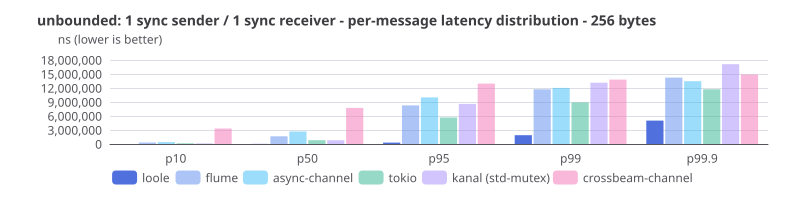
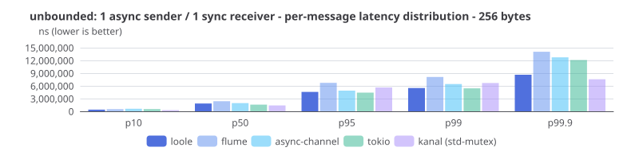
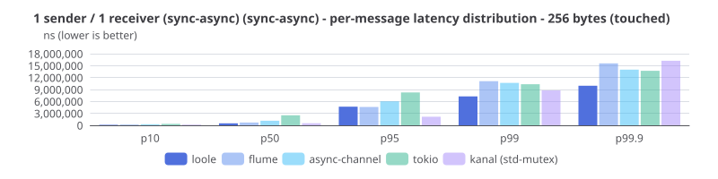
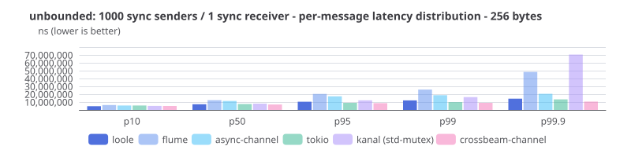
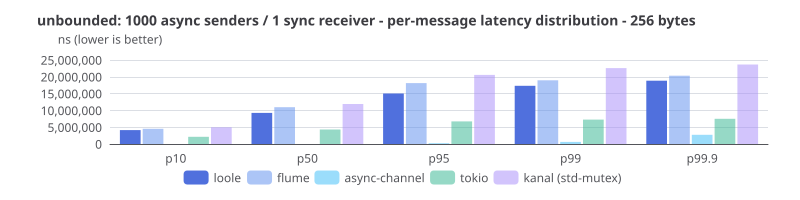
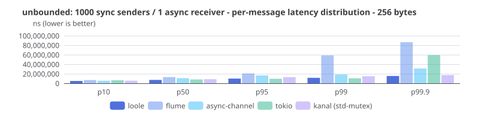
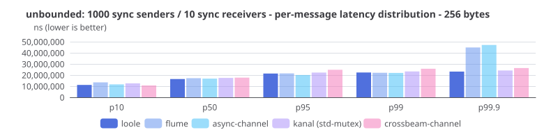
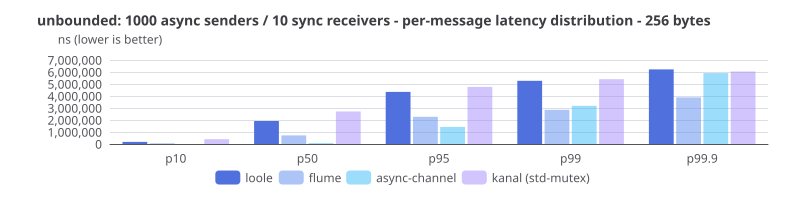
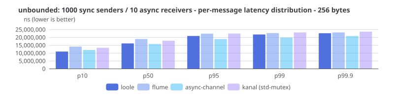

# Latency benchmark results

Ping-pong latency plus per-message queueing-delay distributions under load.
Methodology: [BENCHMARK.md](BENCHMARK.md).

### Latency

Latency is the round-trip time in nanoseconds (lower is better) for a single sender/receiver pair exchanging messages back and forth across two channels (one forward, one back).

#### SPSC

## Per-message latency distribution

Per-message queueing delay under full load, unbounded cells only (where tails
grow unmasked). Rows are percentiles (ns, lower is better); bars are crates.
Each throughput run records a `target/criterion/runs/latency-dist-*.json`
sidecar with these tables; see [Sampling](BENCHMARK.md#sampling).

#### SPSC

#### MPSC

#### MPMC

